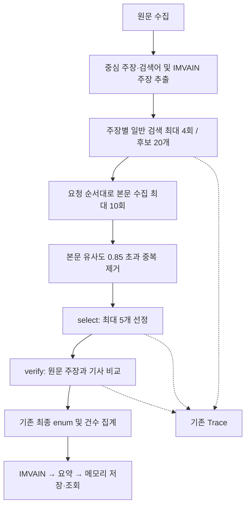
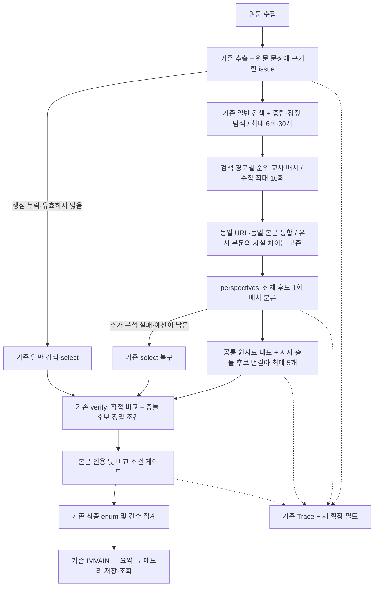

# 쟁점 중심 보도 관점 분석 및 사실 충돌 탐지

기준 커밋: `e8457c7` (교차검증 Trace 및 영역별 결과 조회).
구현은 기존 메모리 작업 저장소·비동기 파이프라인·결과 DTO를 사용한다. DB 변경은 없다.
관점 후보는 최종 판정이 아니며, 원문을 직접 반박하지 않는 외부 기사 간 의견 대립은 상반 건수에 포함하지 않는다.

## 1. 변경 파일과 이유

Java 파일의 공통 경로는 `src/main/java/org/argos/argos_backend/`이다.

| 구분 | 파일 | 변경 이유 |
| --- | --- | --- |
| 신규 | `analysis/domain/ReportingModels.java` | 원문 쟁점, 관점 후보, 비교 조건 및 상반 인정 결과 모델 |
| 신규 | `analysis/service/ReportPerspectivePolicy.java` | 원문 인용 검증, 중립 검색어 조립, 원자료 중복 및 비교 대상 선택, 상반 게이트 |
| 수정 | `analysis/service/AnalysisPipeline.java` | 새 배치 분석·검색·선정·상반 게이트 연결, 부분 실패 복구 |
| 수정 | `external/llm/LlmModels.java` | 기존 추출에 issue 추가, PerspectiveSelection, ReportDecision.conflictCheck 추가 |
| 수정 | `external/search/SearchClient.java` | 검색 요약 및 발행일 힌트 보존 |
| 수정 | `analysis/domain/CrossReportTrace.java` | 새 정보를 기존 오류 격리 경계 안에서 불변 스냅샷에 반영 |
| 수정 | `analysis/dto/CrossReportTraceResponse.java` | 기존 필드에 의미 변경 없이 쟁점·후보·선정 정책·비교 조건 등을 추가 |
| 수정 | `analysis/controller/docs/AnalysisApiDocs.java` | 신규 Trace 의미 및 기존 결과와의 관계 설명 |
| 수정 | `analysis/controller/docs/AnalysisResponseExamples.java` | 기존 예시를 보존하고 관점/충돌 Trace 예시 추가 |
| 신규 | `src/main/resources/prompts/analysis/perspectives.txt` | 모든 수집 후보를 한 번에 분류하고 원문 문장 및 공통 원자료 인용 추출 |
| 수정 | `src/main/resources/prompts/analysis/extract.txt` | 중심성·목적별 독립 추출을 유지하면서 쟁점의 원문 표현 추가 |
| 수정 | `src/main/resources/prompts/analysis/select.txt` | 복구 경로에서도 '수치가 같은 기사만' 고르는 조건 제거 |
| 수정 | `src/main/resources/prompts/analysis/verify.txt` | 직접 반박 여부, 시점·분모·단위·집계 기준·양립 불가능성 정밀 비교 |
| 신규 | `analysis/service/ReportPerspectivePipelineTests.java` (테스트) | 새 파이프라인, 거짓 상반 방지, 검색·수집·비교 한도와 복구 |
| 신규 | `analysis/service/ReportPerspectivePolicyTests.java` (테스트) | 9개 비교 조건, 창작 문장, 수치 비교 생략, 원자료 순환 참조 방어 |
| 수정 | `analysis/service/AnalysisPipelineTraceTests.java` (테스트) | 기존 상반 fixture에 실제 인용과 비교 조건을 명시하고 Trace 회귀 유지 |
| 수정 | `analysis/controller/AnalysisApiIntegrationTests.java` (테스트) | 기존 API 회귀 및 새 비동기 실행→Trace HTTP 조회→IMVAIN 통합 검증 |
| 수정 | `external/llm/OpenAiStructuredLlmTests.java` (테스트) | 새 배치 응답의 파싱 실패·누락·제약 실패 재시도 검증 |
| 수정 | `external/search/SearchClientTests.java` (테스트) | 검색 요약 및 날짜 힌트 보존 검증 |
| 수정 | `global/config/OpenApiIntegrationTests.java` (테스트) | 새 Trace 스키마·예시와 기존 최종 판정 enum 보존 검증 |
| 수정 | `support/AnalysisFixtures.java` (테스트) | 인용과 비교 조건을 명시한 공통 충돌 fixture |
| 신규 | `reporting-perspective-pipeline.md` | 변경 파일·전후 흐름·정책·Trace·비용·검증 및 한계 보고 |

테스트 Java 파일의 공통 경로는 `src/test/java/org/argos/argos_backend/`이다.

## 2. 전후 파이프라인

이전:

이후:

이전에도 같은 본문 판정은 원문 제외와 외부 근거 재사용에 각각 적용되었다. 이후 0.85 기준은 원문과 비슷한 후보를 기록하는 데만 쓰며, 교차보도의 본문 통합은 공백·대소문자 정규화 후 동일할 때 수행한다. IMVAIN 수집 정책은 그대로 유지한다.

## 3. 메서드별 Input → Process → Output

| 노드 | Input | Process | Output |
| --- | --- | --- | --- |
| 기존 `extract` + `IssueFrame` | 원문 Document | 중심 사실 주장 최대 3개를 유지하고 사건·주체·대상·기간·지표 및 원문 문장 추출 | 기존 DraftCrossClaim + issue |
| `validateIssue` | issue, 원문 | 문장 최대 1000자, 각 쟁점 표현 최대 80자 및 문장 내 존재 여부 검증 | 검증 성공 또는 기존 검색/선정으로 복구 |
| `neutralQuery` | 검증된 쟁점 표현 | 원문 표현만 조합, 중복 표현 제거, 최대 280자 | 중립 검색어, 여기에 `정정`을 붙인 탐색어 |
| `searchAll` | provider/query/type | 동일 provider+query 호출 중복 제거, 병렬 검색, 교차보도만 순위별 교차 배치 | 검색 출현별 후보 목록 |
| 기존 `collect` | 후보, EvidencePool | 안전 URL·본문 수집·원문/동일 언론사 제외·동일 본문 재사용 | 최대 10개의 근거 문서 ID |
| 새 `perspectives` | 원문, 핵심 주장, issue, 수집 문서 | 모든 후보를 한 번에 분류, 문장·근거·원자료 연결 추출 | PerspectiveSelection |
| `ReportPerspectivePolicy.validate` | 배치 응답, 실제 문서 | ID 누락/중복, 창작 문장, 존재하지 않는 공통 인용, 순환 참조 거부 | 검증된 분류 또는 기존 select 복구 |
| `ReportPerspectivePolicy.select` | 검증된 후보, 수집 순서 | 원자료 대표 단위로 중복 제거, 지지와 충돌 번갈아 선택 | 최종 비교 후보 최대 5개 |
| 기존 `verify` 확장 | 원문, 주장, 선정 원문·인용·후보 분류 | 후보를 정답으로 취급하지 않고 직접 재비교, 상반이면 비교 조건 평가 | 기존 stance/reason + conflictCheck |
| `resolve` | conflictCheck, 실제 원문·외부 본문, 유효 issue | 직접 원문 인용·외부 인용, 9개 조건, 수치 비교 및 양립 불가능성 게이트 | 인정/탈락 및 이유 |
| 기존 결과 집계 | 통과한 MATCHES/CONTRADICTS | 기존 집계와 enum 매핑 | MATCHED / CONTRADICTED / MIXED / UNCONFIRMED |

## 4. 검색·후보 정책

- 기존 EXACT/EXPANDED 각각 NAVER/BRAVE 검색을 유지한다. 동일 제공자·문자열은 한 번만 호출한다.
- 유효 쟁점이 있으면 NAVER 중립 검색과 BRAVE 정정 탐색을 각각 최대 한 번 추가한다. 정정 탐색은 사실 주장을 추가한 것이 아니며 검색 결과의 입장을 정하지 않는다.
- 응답은 요청당 최대 5건, 총 최대 30건이다. 기사 수집 시도 최대 10회, 최종 비교 최대 5개는 유지한다. 캐시 재사용 및 수집 후 제외도 기존처럼 수집 시도 예산을 사용한다.
- 경로별 1위, 경로별 2위 순으로 수집하므로 일반 검색 결과만으로 수집 예산이 먼저 소진되지 않는다. IMVAIN에는 이 교차 배치를 적용하지 않는다.
- 본문이 거의 같더라도 숫자/부정/정정이 다른 후보를 버리거나 같은 evidenceId로 합치지 않는다. 실제 동일 본문은 기존처럼 합친다.
- 같은 원보도/보도자료 중복 연결은 두 본문에서 확인한 20자 이상의 공통 원자료 인용이 있어야 하며, 같은 후보 분류 내에서만 허용한다. 단순 키워드만으로 묶지 않는다.
- 무관·정보 부족·관점 차이 후보는 비교 개수를 채우기 위해 선정하지 않는다. 한쪽 유형이 없으면 있는 유형에서만 선정한다.

## 5. 관점과 최종 상반의 차이

`SUPPORT_CANDIDATE`, `CONFLICT_CANDIDATE`, `DIFFERENT_PERSPECTIVE`, `IRRELEVANT`, `INSUFFICIENT`는 내부 분석/Trace용이다. 기존 결과 enum에 추가하지 않았다.

분류의 statement는 실제 quote 내부 표현이어야 하고, quote도 본문에 존재해야 한다. 후보 분류 및 reason은 모델 평가다. 감성·해석·전망 차이는 사실 충돌이 아니다.

최종 CONTRADICTS는 다음이 모두 필요하다.

1. 원문 주장을 뒷받침하는 인용과 외부 반박 인용이 각각 본문에 존재한다. 유효 issue가 있다면 원문 인용은 그 쟁점의 originalQuote 안에도 있어야 한다.
2. sameEvent / sameSubject / sameTarget / samePeriod는 SAME이다. UNKNOWN·DIFFERENT·NOT_APPLICABLE은 통과하지 않는다.
3. sameMetric / sameUnit / sameDenominator / sameAggregation / sameConditions는 SAME 또는 실제로 비교 자체가 불필요한 NOT_APPLICABLE이다.
4. 지원하는 수치·단위 표현이 발견되면 지표·단위·집계 기준을 NOT_APPLICABLE로 생략할 수 없다. 백분율에서는 분모도 SAME이어야 한다.
5. mutuallyExclusive=true이며 구체적인 설명이 있다.

모델이 CONTRADICTS라고 답해도 게이트에 실패하면 최종 집계에서 제외한다. 지지 근거가 남으면 MATCHED, 모든 비교가 제외되면 UNCONFIRMED다. 상반으로 바꾸거나 일치 결과를 만들어 채우지 않는다.

## 6. Trace 확장

기존 후보 ID·검색 요청·이벤트·comparison·선정 ID·판정 필드를 보존한다.

- 주장: issue, neutralQuery, challengeQuery, enrichmentIssues.
- 검색: QueryType에 NEUTRAL/CHALLENGE 추가. 원래 검색 출현 수는 candidates.size 및 searches[].resultCount로 확인한다.
- 후보: 검색 요약·날짜 힌트, 수집 후 URL/제목/언론사/발행일/잘림 여부, claimAnalysis.
- 원자료: duplicateOfEvidenceId와 두 본문에서 확인한 sharedOriginQuote.
- 새 경로의 선정: verificationSelection.selected/reason 및 PERSPECTIVE_SELECTED/PERSPECTIVE_NOT_SELECTED 이벤트.
- 충돌: conflictResolution.check는 모델 판단이고 accepted/reason은 서버 게이트 결과다. 기존 comparison은 실제 모델 stance/reason을 그대로 보존하므로 거절된 CONTRADICTS도 보일 수 있다.
- 최종 사용 인용: usedQuotes. 선정됐어도 게이트에서 탈락하거나 UNRELATED라면 비어 있다.
- 유사 원문 보존: SIMILAR_CONTENT_RETAINED 이벤트.

기존 llmSelected는 기존 select 응답의 선정 여부로만 사용한다. 새 정책 선정에 재사용하지 않는다. 원문 URL 중복으로 처리하지 않은 별도 검색 출현에는 수행하지 않은 분석 기록을 만들지 않는다.

모든 변경은 기존 AnalysisContext.trace의 동기화·RuntimeException 격리를 사용한다. 전문·API 키·인증 헤더·임의 예외 메시지를 로그에 추가하지 않았다.

## 7. API 및 Swagger

- 기존 요청, 상태, result의 all/cross-report/source 응답 필드 및 최종 enum 유지.
- 새 조회 API나 DB 테이블 없이 기존 `/api/v1/analyses/{id}/cross-report/trace`에 확장 정보 제공.
- 결과 UI는 기존 결과로 최종 판정을 표시하고 Trace로 별도 관점 정보를 표시할 수 있다. 프런트엔드 코드는 이 저장소에 없어 UI 구현은 포함하지 않았다.
- Swagger에 확장 필드와 새 예시 추가. 기존 예시는 복구/레거시 경로의 예시로 유지.
- Trace QueryType에만 enum 값이 늘어난다. Trace 소비자가 이를 닫힌 enum으로 처리한다면 대응이 필요하다.
- IMVAIN 검색어·분류·결과 DTO·평가 프롬프트는 바꾸지 않았다.

## 8. 비용·성능·실패 대응

- 정상 교차보도: 기존 extract 1회, 주장별 select+verify를 perspectives+verify로 대체한다. 외부 기사마다 LLM을 호출하지 않는다.
- 한 주장에서 관점 분석 응답을 최대 두 번 생성한 후 실패하면 기존 select로 복구할 수 있다. 따라서 실패 경로에는 추가 LLM 호출 비용이 발생할 수 있다. HTTP 재시도 정책도 그대로 적용된다.
- 일반 검색 최대 4회에서 최대 6회로 증가한다. 수집·최종 비교 한도는 그대로다.
- 기존 최대 30,000자 본문·LLM max_output_tokens=12,000·HTTP 제한·작업 10분 기본값·125초 잔여 예산 검사·비동기 상태 흐름을 유지한다.
- perspectives에 원문 본문이, verify에 원문 본문이 추가되어 주장당 입력은 이전보다 최대 약 60,000자와 쟁점/분류 메타데이터만큼 증가한다. 배치 출력도 기존 select보다 크다. 실제 토큰·요금·지연은 측정하지 않았다.
- 쟁점 검증 실패나 관점 분석 실패는 경고와 enrichmentIssues를 남기고 기존 경로로 복구한다. 실제 전체 작업 기한 만료는 기존 정책대로 FAILED가 될 수 있다.
- 검색·본문·최종 검증 실패의 기존 판단 보류·부분 결과 정책을 유지한다. 모든 분석 항목이 실패하면 기존 전체 실패 정책을 따른다.
- 메모리 저장 및 24시간 만료·재시작 시 유실 정책은 그대로다.

## 9. 검증

유료 API 없이 Mockito 기반 검색·본문·LLM fixture 및 기존 로컬 HTTP 통합 테스트를 사용했다.

- 원문 지지와 실제 동일 조건 수치 충돌.
- 양립 가능한 긍정/부정 해석, 외부 기사끼리만의 전망 차이.
- 다른 사건·기간, 제목뿐인 반박, 근거 부족.
- 동일 보도자료 재사용, 높은 본문 유사도 속 수치 정정.
- 지지 후보가 5개 이상일 때 충돌 후보 전달.
- 검색 경로별 수집 기회, 30개 중 수집 10회·최종 비교 5개 유지.
- 창작 statement/quote, 후보 누락, 파싱 실패, 추가 노드 타임아웃 및 복구.
- 모든 9개 비교 조건의 UNKNOWN/DIFFERENT 거절, 수치 비교의 NOT_APPLICABLE 우회 방지.
- 기존 Trace 저장 실패 격리·조회·스냅샷 불변성, IMVAIN, API 및 Swagger 회귀.

최종 검증: `./gradlew build --offline` 성공. JUnit XML 합계는 **142건, 실패 0, 오류 0, 건너뜀 0**이다. `git diff --check`도 통과했다. 중간 실행에서는 124건 중 2건, 이후 확장 실행에서 140건 중 1건이 실패했고, 모의 후보 처리 누락·유사도 fixture·중복 검색 출현의 미처리 상태 기대를 수정하여 다시 검증했다. 테스트 실패를 숨기거나 테스트를 비활성화하지 않았다.

## 10. 한계 및 추가 검증

- 실제 LLM의 의미 분류 정확도·중립 검색 재현율·실제 공급자 지연/비용은 유료 API를 호출하지 않아 확인 불가다. fixture는 코드의 정책·검증·복구 동작을 검증한다.
- 같은 사건/기간/분모인지와 양립 불가능성은 여전히 LLM 의미 판단이다. 코드는 인용 존재와 비교 조건 값의 일관성을 검증하며 진실 자체를 증명하지 않는다.
- 수치 생략 방어의 단위 탐지는 제한된 표현을 처리한다. 다른 언어·한글 수사·복잡한 통계 정의는 모델 조건 판단과 추가 fixture가 필요하다.
- 원자료 인용이 전혀 공통으로 남지 않는 완전한 재서술·은폐된 전재는 중복이라고 확정할 수 없다. 연결 없음은 독립 취재의 증명이 아니다.
- 원문과 같은 언론사/호스트의 정정 보도는 기존 정책에 따라 제외된다. 이 정책의 변경은 하지 않았다.
- 원문·외부 본문 30,000자 밖, 본문 수집 실패, 최대 10회 수집 한도 밖에만 있는 충돌은 놓칠 수 있다.
- 정정 탐색은 보완 경로 한 개다. 추가 키워드별 대규모 검색이나 외부 기사 전체 쌍 비교·자동 진실 판정은 구현 범위에 포함하지 않았다.
- Trace에 전문을 보관하지 않아 사후 의미 판단의 완전 재현은 불가능하다. 확인 가능한 문장·조건·선정·탈락 이유를 보존한다.
