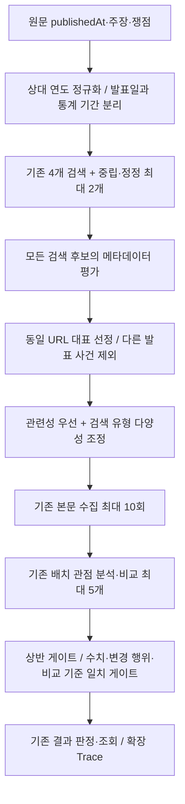

# 시간 맥락·수집 우선순위·변경 행위 일치 검증 개선

기존 미커밋 보도 관점 구현 위에 적용한 변경이다. 기존 작업을 삭제·초기화하지 않았으며 DB, 공개 결과 DTO, 최종 판정 enum, IMVAIN 검색·평가 정책은 유지했다.

## 변경 경로

## 시간 맥락

- `ReportRetrievalPolicy.normalizeYears`: 현재 시각 대신 원문 `publishedAt`의 Asia/Seoul 연도를 사용한다. 2025년 기사에서 올해는 2025년, 내년/내년도는 2026년이다. 원문 인용은 변경하지 않는다.
- `IssueFrame.announcementDate`: 기사 제목·본문에서 그대로 복사한 발표 날짜 표현이다. 기존 6인자 생성자는 유지했다.
- `TemporalContext`: originalPublishedAt, announcementDate, announcementDateSource, targetPeriods, numericAnchors, eventAnchors, action을 보관한다.
- 발표일은 원문 날짜 표현을 우선한다. `2월 25일`, `25일` 등은 원문 발행 연도·월을 참조한다. `지난 25일`이 발행일보다 늦은 일자이면 직전 달을 사용한다. 날짜가 확인되지 않으면 발행일을 검색 앵커로 사용하되 `PUBLISHED_AT_FALLBACK`이라고 표시한다. 이는 사건 발생일 확정이 아니다.
- 통계 기간은 별도 보관하며, 주장에 포함된 올해·내년 등 두 번째 대상 연도도 유지한다. 완전한 발표 날짜에 포함된 연도를 통계 기간으로 중복 추출하지 않는다.
- 원문 발행일이 없으면 상대 연도를 현재 연도로 임의 치환하지 않는다. 검색 후보의 발행일이 없을 때도 후보의 '올해'에 원문 발행 연도를 빌려 쓰지 않는다.
- EXACT/EXPANDED도 상대 연도를 정규화한다. NEUTRAL/CHALLENGE에는 발표 연도·월일, 통계 대상 기간 및 원문 핵심 수치를 추가한다. 검색어 길이 한도 안에서 이 앵커 공간을 먼저 확보한다.
- 숫자가 검색어와 같다는 이유로 일치 판정을 내리지 않는다. 다른 수치의 반박을 찾는 일반 확장 경로도 유지한다.

## 수집 전 전체 후보 평가

검색 요청 수와 공급자별 요청당 5개 제한은 그대로다. 최대 30개 검색 출현 전체를 평가한 뒤 본문 수집 순서를 결정한다. 검색 API 또는 LLM 호출은 추가하지 않는다.

| 신호 | 기본 점수/처리 |
| --- | --- |
| 주체·대상·사건·지표 표현 일치 | 표현당 +6, 최대 +24 |
| 원문 핵심 수치 일치 | 수치당 +12, 최대 +24 |
| 통계 대상 기간 표현 일치 | 표현당 +5 |
| 발표 연도 / 월일 표현 일치 | +16 / +18 |
| 후보 발행일이 사건일에서 14일 이내 | +3의 약한 보조 신호 |
| 관련 앵커가 있는 정정·회고 표현 | +3, 늦은 발행일로 배제하지 않음 |
| 메타데이터 본문에서 다른 날짜의 발표·전망·결정 식별 | -45. 원사건의 정확한 날짜·원문 수치·정정/회고 연결도 없으면 수집 제외 |
| 같은 URL의 반복 검색 출현 | 가장 관련성 높은 출현을 대표로 사용, 나머지는 수집 제외 |

정확한 사건 날짜 일치는 같은 날짜 표현 안의 연·월·일로 확인한다. 예를 들어 `2026년 2월 25일 발표`의 월일과 별도 `2025년 통계`의 연도를 조합해서 2025년 사건이라고 취급하지 않는다.

발행일만으로 후보를 확정하거나 제외하지 않는다. 단지 다른 연도가 언급되었다는 이유만으로도 제외하지 않는다. 메타데이터가 부족한 후보는 낮은 우선순위로 유지한다. 수치가 다르더라도 같은 발표 사건의 직접 보도·정정이면 남길 수 있다.

관련성이 비슷할 때 EXACT/EXPANDED/NEUTRAL/CHALLENGE 유형별 기회를 분산한다. 이미 배정한 유형에는 1회당 4점, 최대 12점의 조정을 적용한다. 명백히 약한 후보를 유형별 할당량을 채우기 위해 강제 수집하지 않는다.

본문 수집은 기존 최대 **10회**, 최종 비교는 최대 **5개**를 유지한다. IMVAIN에는 이 교차보도 우선순위 정책을 적용하지 않는다.

## MATCHED 방어

`ReportDecision.matchCheck`와 서버의 `MatchResolution`을 추가했다. 기존 Java 생성자도 유지했다.

주장에 유지/동결/상향/하향 등의 변경 행위가 있으면 MATCHES 응답만으로 집계하지 않는다. 다음을 모두 확인한다.

1. 동일 사건, 통계 대상 기간, 수치, 변경 행위, 비교 기준에 대한 모델 평가가 모두 SAME이다. UNKNOWN이나 필드 누락은 보류한다.
2. 원문 인용과 외부 인용이 각 본문에 실제 존재한다. 유효 쟁점이 있으면 원문 인용은 해당 쟁점 원문 문장 안에도 있어야 한다.
3. 외부 인용에 해당 행위 표현과 주장에 필요한 수치가 실제로 있다. 단순 `1.5%로 전망했다`는 `종전 1.5%를 유지했다`의 근거가 아니다.
4. 기본 수치 표기는 정규화한다. 1.5%와 1.50 퍼센트는 같은 표기로 취급하지만 %와 %p는 구분한다. 검색 앵커는 최대 6개지만 최종 수치 대조는 그 뒤의 값도 확인한다.

변경 행위가 없는 주장은 기존 직접 사실 비교를 유지한다. 검증에 실패한 MATCHES는 최종 comparisons/건수에서 제외한다. 모든 비교가 제외되면 UNCONFIRMED이며 상반으로 바꾸지 않는다. 기존 상반 게이트는 유지했다.

## Trace와 API

- `claims[].temporalContext`: 원문 기준 시간 맥락, 발표일 출처, 통계 기간·숫자·사건 앵커.
- `candidates[].prefetchPriority`: 모든 검색 출현의 수집 전 rank, 기본 score, eligible, 이유. rank는 유형 다양성 조정까지 적용한 수집 순서이고, 조정량도 reasons에 남긴다.
- `PREFETCH_REJECTED`: 메타데이터에서 다른 발표 사건이 식별되어 본문 수집에서 제외. `DUPLICATE_URL`은 기존 의미를 유지한다.
- 기존 `COLLECTION_LIMIT_REACHED`: 적격 후보 중 기존 수집 예산으로 처리하지 못한 경우.
- `candidates[].matchResolution`: 변경 행위 일치의 인정/보류 및 이유.
- 기존 comparison은 원래 모델 stance/reason을 보존한다. 따라서 raw MATCHES와 matchResolution.accepted=false가 함께 보일 수 있다. 최종 결과 집계는 서버 게이트 통과 후 생성한다.
- 결과 API의 필수 필드·최종 enum·section 구조는 유지하고, 기존 Trace API에만 확장 필드를 추가했다. Swagger 스키마·설명·예시와 스키마 회귀 테스트를 갱신했다.
- 기존 동기화·Trace 오류 격리를 사용한다. API 키나 인증 헤더를 로그에 추가하지 않았다.

## 이번 작업의 변경 파일

Java 공통 경로: `src/main/java/org/argos/argos_backend/`.

| 구분 | 파일 | 이유 |
| --- | --- | --- |
| 신규 | `analysis/service/ReportRetrievalPolicy.java` | 시간 정규화·검색 앵커·전체 메타데이터 순위·행위/수치 대조 |
| 수정 | `analysis/service/AnalysisPipeline.java` | 검색→우선순위→수집 및 MATCHES 게이트 연결 |
| 수정 | `analysis/service/ReportPerspectivePolicy.java` | 발표 날짜 원문 검증·수치/행위/기준 일치 게이트 |
| 수정 | `analysis/domain/ReportingModels.java` | 발표일·시간 맥락·우선순위·일치 검증 모델 |
| 수정 | `external/llm/LlmModels.java` | 기존 ReportDecision에 matchCheck 추가 |
| 수정 | `analysis/domain/CrossReportTrace.java` | 새 진단 정보의 스냅샷 기록 |
| 수정 | `analysis/dto/CrossReportTraceResponse.java` | 기존 필드 의미를 보존한 Trace 확장 |
| 수정 | `analysis/controller/docs/AnalysisApiDocs.java` | 시간·우선순위·일치 보류의 의미 설명 |
| 수정 | `analysis/controller/docs/AnalysisResponseExamples.java` | 실제 새 검색어·시간 맥락·우선순위 예시 |
| 수정 | `src/main/resources/prompts/analysis/extract.txt` | 발표일과 통계 기간 구분, 변경 행위·기준 보존 |
| 수정 | `src/main/resources/prompts/analysis/select.txt` | 복구 경로의 시간 맥락 보존 |
| 수정 | `src/main/resources/prompts/analysis/perspectives.txt` | 다른 회차 발표와 후속 정정 구분 |
| 수정 | `src/main/resources/prompts/analysis/verify.txt` | 상대 시점·발표 회차·변경 행위·비교 기준 검증 |
| 신규 | `analysis/service/ReportTemporalRetrievalTests.java` (테스트) | 날짜 정규화·전체 후보 순위·정정·다양성·수치/행위 검증 |
| 수정 | `analysis/service/ReportPerspectivePipelineTests.java` (테스트) | 30번째 직접 후보 수집, 다른 연도 29개 제외, 수치뿐인 유지 주장 보류 |
| 수정 | `global/config/OpenApiIntegrationTests.java` (테스트) | 확장 Trace 및 기존 결과 계약 검증 |
| 신규 | `temporal-retrieval-improvements.md` | 변경 정책·검증·한계 보고 |

테스트 공통 경로: `src/test/java/org/argos/argos_backend/`.

## 검증 및 한계

유료 API 없이 mock/fixture와 기존 로컬 HTTP 통합 테스트를 사용한다. 검증 사례는 2025→올해 2025/내년 2026, 발표/통계 기간 분리, 다른 연도 발표 우선순위 하락·제외, 늦은 정정 보존, 모든 검색 후보 평가, 유형 다양성, 중복 URL, 직접 대조 기사 수집, 변경 행위와 비교 기준 누락 시 일치 보류, 기존 Trace·IMVAIN·API 회귀다.

초기 전체 실행의 기존 테스트 1건은 이전 정책의 '중립 검색에 원문 수치를 포함하지 않음' 기대값 때문에 실패했다. 이번 요구에 따라 수치 앵커를 보존하도록 기대값을 변경한 후 다시 검증했다. 테스트를 비활성화하지 않았다.

최종 검증: `./gradlew build --offline` 성공. JUnit XML 합계는 **160건, 실패 0, 오류 0, 건너뜀 0**이다. 시간·수집 정책 테스트 16건, 확장 파이프라인 테스트 19건 및 기존 Trace·IMVAIN·API 회귀를 포함한다. `git diff --check`도 통과했다. 재현 fixture에서는 검색 목록의 30번째 직접 대조 기사를 우선 수집하고 다른 2026년 발표 29개는 본문 수집 전에 제외했다. 이는 실제 검색 공급자 측정 결과가 아닌 오프라인 정책 검증 결과다.

수집 전 정책은 설명 가능한 문자열·날짜 휴리스틱이다. 기관 약칭, 복잡한 회고 표현, 과거 인용 속 상대 날짜, 누락된 발행일, 표·복잡한 통계와 단위 변환을 완전히 해석하지는 못한다. 발행일 fallback과 월/연도 보충은 시간 앵커이며 사실 확정이 아니다. 모델의 의미 판단은 실제 유료 API로 검증하지 않았다. 비용·API 횟수 상한·작업 타임아웃은 유지하지만 matchCheck 출력 토큰은 증가할 수 있다. 수집·비교 한도 밖의 누락 가능성도 남아 있다.

외부 유료 API·운영 서비스 호출, 시크릿 수정, 커밋·푸시·배포는 수행하지 않았다.
